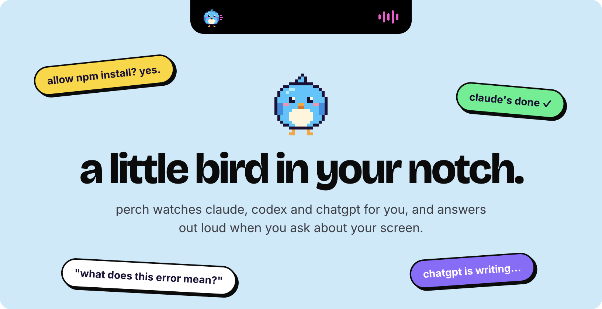
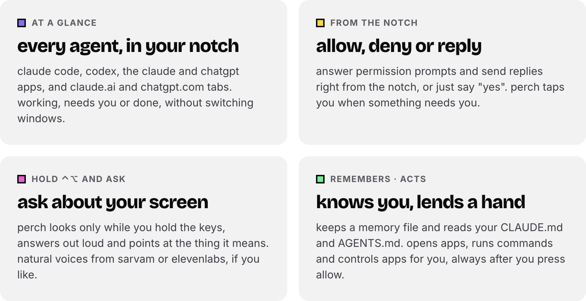
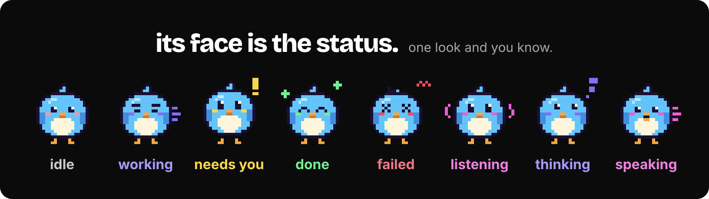

  

  
  
  
  

  <a href="https://agentperch.in/Perch.dmg"><b>Download for Mac</b></a> ·
  <a href="https://agentperch.in">Website</a> ·
  <a href="https://agentperch.in/releases.html">What's new</a> ·
  <a href="https://agentperch.in/privacy.html">Privacy</a>

## What Perch does

  

  

## Get started in a minute

1. **Download** [Perch.dmg](https://agentperch.in/Perch.dmg) and drag Perch to Applications.
2. First open only: macOS says it can't verify Perch. Go to **System Settings → Privacy & Security → Open Anyway**.
3. Follow the short setup: connect Claude Code or Codex, then hold <kbd>⌃</kbd> <kbd>⌥</kbd> and ask something.

> [!NOTE]
> Needs macOS 14.2 or later. Voice answers use your own Claude Code or Codex, so there's nothing extra to pay for.

## Works with

| Agent | What Perch shows |
| --- | --- |
| Claude Code · Codex | working, needs you, done · **Allow / Deny** from the notch |
| Claude app · ChatGPT app | live status and **Reply** · Allow / Deny for the Claude app |
| claude.ai · chatgpt.com | every tab in its own row, with the free [Perch for Claude](https://chromewebstore.google.com/detail/hmdbopjogocjdopbcmcmheceojclibnd) extension |

## Private by design

- No account, no server, no API key. Answers come from your own Claude Code or Codex.
- Your screen is seen only while you hold <kbd>⌃</kbd> <kbd>⌥</kbd>, and the screenshot is never kept.
- Agent activity and chats stay on your Mac (127.0.0.1). Memory is a plain file you can edit.
- Nothing runs on your Mac until you press **Allow**.
- Crash reports and the user count are off unless you say yes.

Read the full [privacy page](https://agentperch.in/privacy.html).

## FAQ

**Is it really free?**
Yes. Perch uses the Claude or ChatGPT plan you already have. Natural cloud voices (Sarvam, ElevenLabs) are optional and use your own key.

**My Mac has no notch.**
Perch sits in the middle of the menu bar instead, and you can drag it anywhere along the top.

**What if Perch isn't running?**
Your agents work exactly as before. Perch never blocks them.

**Found a bug?**
Use **Send feedback** in Perch's menu, or [open an issue](https://github.com/ShreySigh2912/perch-mac/issues).

---

   
  made by shrey · <a href="https://agentperch.in">agentperch.in</a> 
  perch is free and independent, not affiliated with anthropic or openai.

